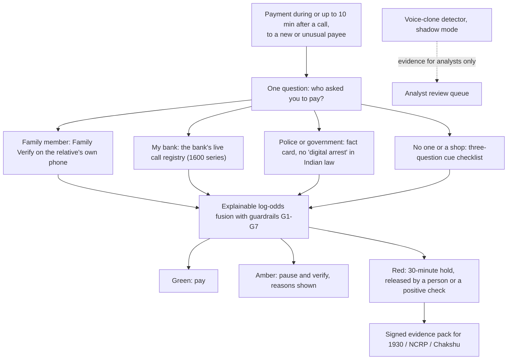

# Pehchaan (पहचान): verify the person, not the voice

Pehchaan protects UPI and bank payers from voice-cloning fraud. It runs inside a bank or UPI app as an SDK and a
risk API. When someone starts a risky payment during or just after a call, it asks one question, *"Who asked you to
pay?"*, and checks the answer through a channel a cloned voice cannot reach.

Team **humanslop** (IIT Bhilai), RAKSHAM AI Cybersecurity Hackathon, Track 01: voice-cloning fraud detection.
Finale at IIT Delhi, 24-25 October 2026.

## How it works



- **The trigger** uses call metadata and payment details only. No call audio leaves the phone.
- **The claim check** goes out of band: the relative's own phone, the bank's registry or a family safe word.
- **The decision** is an explainable log-odds fusion. Every likelihood ratio and its basis is in
  `engine/pehchaan/config.yaml`, and hard guardrails sit on top (SPEC section 4).
- **The voice detector never moves money** (guardrail G2). It runs in shadow mode until it passes a real-call gate,
  and its hits go to an analyst.

## Repository layout

| Path | Contents |
|---|---|
| `SPEC.md` | Product and detection specification (v0.3). Behaviour changes go here first |
| `engine/` | Fusion engine, guardrails, English/Hindi copy, evidence pack, session simulator (pytest) |
| `app/server/` | FastAPI risk API: cases, Family Verify with device-signed answers, mocked registries, red-team runner (pytest) |
| `app/web/` | React demo: payer phone (DemoPay), relative phone, analyst console, detector bench, benchmark |
| `app/android/` | Android app (Capacitor shell + Kotlin SDK): real call state, on-device contact check, Family Verify notifications |
| `ml/` | Detector training, evaluation and the voice service (`ml/serve`) |
| `ml/realcall/` | Real phone-call collection, consent registry, learned phone channel, live attack-call agent (pytest) |
| `ml/infra/` | GPU training scripts (AWS) |
| `deploy/` | Docker Compose and Caddy for `api.humanslop.in` and `demo.humanslop.in` |
| `deck/` | Pitch deck source; `python deck/build.py` builds `deck/out/deck.pdf` |
| `data/recording-kit/` | Recording scripts and consent forms (recordings themselves are never in git) |
| `research/`, `research_notes/`, `reports/` | Cited research behind the product and the deck |

## Running it on your own machine

Works on Linux, macOS and Windows. The demo needs no keys, no model weights and no phones: every bank, registry
and voice adapter has a built-in mock, and all people, banks and UPI IDs are fictional.

### 1. Prerequisites

| Tool | Version | Check |
|---|---|---|
| Python | 3.11 or later (3.12 recommended) | `python3 --version` |
| Node.js | 20 or later (22 for the Android build) | `node --version` |
| Git | any recent | `git --version` |
| ffmpeg | optional; only for scoring mp3/m4a/webm audio | `ffmpeg -version` |

### 2. Get the code and create a Python environment

```bash
git clone https://github.com/Galabavamsi/pehchaan.git
cd pehchaan
python3 -m venv .venv
source .venv/bin/activate          # Windows: .venv\Scripts\activate
pip install --upgrade pip
pip install -r app/server/requirements.txt
pip install -e engine
```

### 3. Check everything works

```bash
cd engine && python -m pytest -q && cd ..
cd app/server && python -m pytest -q && cd ../..
```

Expected: engine 87 passed, API 41 passed.

### 4. Run the demo (two terminals)

Terminal 1, the risk API on port 8400:

```bash
cd app/server
python -m uvicorn pehchaan_api.main:app --port 8400
```

Terminal 2, the web demo on port 5173:

```bash
cd app/web
npm install
npm run dev
```

Open `http://127.0.0.1:5173/#/demo`. Click **T1** (cloned son), then on Sunita's phone tap **Pay**, **Family member**,
**Rahul**; on Rahul's phone open the notification and tap **No, that's not me**. The payment is held and the bank
console updates. **L2** is the genuine son (tap **Yes, it's me**: paid). **Your case** builds any scenario.

Other pages: `#/console` (fraud analyst), `#/bench` (detector bench), `#/benchmark` (clone-vs-detect results),
`#/redteam`, `#/tour`. The full demo script is in `app/README.md`.

### 5. Optional: the voice-clone detectors

Without the detector service the API uses a mock voice score, and the demo works as shown. To run the real
detectors you need the model weights (about 1.3 GB each, kept in the team's private S3 bucket, not in git):

```bash
pip install -r ml/serve/requirements.txt
cd ml
PEHCHAAN_DEVICE=cpu python -m uvicorn serve.app:app --port 8500                       # served model v1 only
PEHCHAAN_DEVICE=cpu PEHCHAAN_PANEL=v1,A,nii,n3 PEHCHAAN_FUSE=n3 python -m uvicorn serve.app:app --port 8510   # full panel, about 7.5 GB RAM
```

Then start the API with `VOICE_SERVICE_URL=http://127.0.0.1:8500` (or `8510`). Weight locations: `ml/serve/` and
`ml/runs/<model>/best.pt`; see `ml/README.md`.

### 6. Optional: Docker, Android app, real calls

- **Docker (API + voice service):** `docker compose -f deploy/docker-compose.yml -f deploy/compose.local.yml up --build api voice`
  (`deploy/README.md`).
- **Android app:** Node 22, JDK 21, Android SDK 36. `cd app/web && npm run build && npx cap sync android`, then
  `cd ../android && ./gradlew assembleDebug`; install the APK on two phones, choose Sunita on one and Rahul on the
  other.
- **Real phone calls and the live cloned-voice caller** need telephony and speech API keys in a repo-root `.env`
  (never committed) and consent forms on file; see `ml/realcall/README.md`.

Secrets (`.env`), participant phone numbers (`ml/realcall/participants.yaml`), audio and model weights are not in
git.

## Results

Every number below traces to the file named next to it. Single training seed throughout.

### Voice-clone detector (shadow mode)

| Test | Result | Source |
|---|---|---|
| Real phone calls, pre-registered test split (510 clips, two handsets, Jio) | Reference model n3: EER 7.8 %, genuine flagged 3/256, clones caught 190/254. Previous model A: EER 11.0 % | `ml/realcall/FINDINGS.md`, v5 section |
| Before and after retraining on real calls (handset D1) | v1 24.6 % EER, model A 6.8 % | `ml/realcall/FINDINGS.md` |
| Handset never used in training (D2) | Model A 11.7 % EER | `ml/realcall/FINDINGS.md` |
| Simulated phone channels | Off-the-shelf XLS-R + AASIST 34.3 % EER, NII MMS-300M 15.1 %, our v1 4.8 % | `ml/results/metrics.json` |
| Known failure | Sarvam instant clones of a speaker no model was trained on, over a real call: 0/12 caught by every model we trained, n3 included | `ml/realcall/FINDINGS.md` |

The detector misses commercial instant clones of new speakers over the phone. That is why the system checks the
person through an independent channel and never lets the voice score hold or release money.

### Decision engine

| Measure | Result | Source |
|---|---|---|
| Simulated triggered payments, prior 1/400 (assumption-driven, not measured) | Genuine: 5.6 % paused, 0.21 % held. Scams: 95.1 % paused, 72.6 % held | `engine/results/deck_numbers.json` |
| Red team: 15 attacks and 1 genuine check through the live API | 7 stopped, 6 paused and asked, 2 not caught | `RED_TEAM.md` |
| Live run on two real phones with a cloned-voice call | Pay to hold in 14 s | `ml/realcall/FINDINGS.md`, live system checks |
| Risk decision latency, in-process | p95 3.95 ms | `app/server/latency.json` |

## Data, consent and licences

- **People:** only consenting team members' voices are cloned or used in calls and demos. `ml/realcall/consent.py`
  refuses to record, call or clone anyone without a saved consent form.
- **Open datasets:** voices from openly licensed datasets (for example IndicVoices, CC-BY-4.0) were cloned with
  open-source tools for detector research only. They never appear in a call, a demo or a release.
- **Screens:** demo screens use fictional names, banks and UPI IDs.
- **Licences:** every dataset and model is listed with its licence in `ml/DATA_CARD.md`. Several are
  non-commercial, including the NII weights that the reference detector n3 is built on. A commercial deployment would
  retrain without them.
- **Deletion:** team recordings and derived data are deleted by 31 December 2026, as the consent forms promise.
